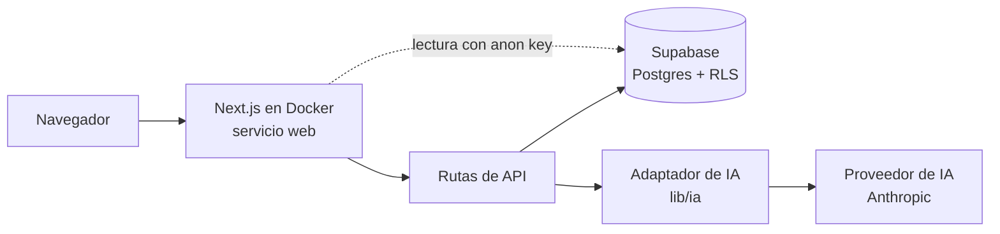

# Demand Planning AI

Agente de reposición de stock para pymes chilenas: sube tus ventas (un Excel, un PDF del proveedor o un texto copiado de WhatsApp) y recibe **qué pedir y cuándo**, con el motivo en palabras simples.

**Demo pública (sin cuenta):** https://demand-planning-ai.onrender.com · **Código:** https://github.com/ChesteryMike/demand-planning-ai

Proyecto final del curso *Advanced Prompt Engineering 4 Generative AI* (UAI) · Grupo 9: Gary López, Jonathan Rodriguez, Rafael Palma y Marlene Valencia. La especificación completa está en [`PROMPT_MAESTRO.md`](PROMPT_MAESTRO.md).

## 1. La idea

- **Cliente:** dueño o encargado de compras de una pyme chilena de venta de productos físicos (panadería, almacén, minimarket, distribuidora pequeña). No es técnico.
- **Problema:** compra "a ojo". Pierde ventas por quiebres que no ve venir, porque no considera cuánto demora cada proveedor, y pierde plata por mermas y por stock inmovilizado.
- **Propuesta de valor:** sube lo que ya tiene y recibe una lista de qué y cuándo pedir. La IA es clave en la entrada: sin el Normalizador, el comerciante tendría que ordenar sus datos a mano antes de usar la app.
- **Principio rector:** el modelo interpreta texto y sugiere ajustes; **el código calcula y valida**. Ninguna cifra de stock, riesgo, fecha, cantidad o pronóstico base sale de un modelo de lenguaje.

### Modelo de ingresos y costo

Suscripción mensual por local (propuesta; **en esta versión no se implementa el cobro ni el límite de 15 productos**):

| Plan | Incluye | Precio |
|---|---|---|
| **Gratis** | Hasta 15 productos e importación de Excel/CSV, sin IA | $0 |
| **Pyme** | Productos ilimitados, importación de texto/PDF/Word con IA y pronóstico ajustado | $9.990 al mes por local |

Costo de IA por local con `claude-haiku-5-5` (US$ 0,10 por millón de tokens de entrada y US$ 0,50 por millón de salida), con tokens **medidos** con los prompts reales:

| Agente | Tokens (entrada / salida) | Costo por llamada |
|---|---|---|
| Normalizador de importación (promedio del golden set, v3) | 2.104 / 157 | US$ 0,000289 |
| Coherencia de catálogo | 1.123 / 87 | US$ 0,000156 |
| Pronóstico | 2.059 / 108 | US$ 0,000260 |

- **Costo esperado:** 12 importaciones (Normalizador + Coherencia) + 30 pronósticos al mes = 12 × 0,000445 + 30 × 0,000260 = **US$ 0,013 al mes**.
- **Costo máximo:** `TOPE_DIARIO_IA` (200) × 30 × 0,000289 = **US$ 1,73 al mes**. Es menor que el precio del plan, así que no hace falta bajar el tope por negocio.
- **Margen del Plan Pyme sobre el costo de IA:** 99,9 % con el costo esperado y 83,5 % con el máximo, suponiendo 1 US$ = $950 CLP (supuesto a confirmar). No incluye infraestructura: la demo corre en capas gratuitas. Hay más detalle en [`docs/FICHA_NEGOCIO.md`](docs/FICHA_NEGOCIO.md) (PDF: [`docs/FICHA_NEGOCIO.pdf`](docs/FICHA_NEGOCIO.pdf)).

## 2. Cómo usarla

Abre https://demand-planning-ai.onrender.com. No pide cuenta: ves el negocio de demostración **Panadería Don Aldo** (10 productos y 12 semanas de ventas de ejemplo).

> La primera visita después de un rato tarda cerca de 1 minuto: el plan gratuito del servidor se apaga tras 15 minutos sin uso.

Recorrido de la demo en 5 pasos:

1. **Panel:** mira cuántos productos están en quiebre, en merma o en sobrestock y las alertas por urgencia, cada una con su motivo.
2. **Ventas → Ingreso:** pega un texto (por ejemplo, ventas copiadas de WhatsApp) o sube un archivo. La IA separa las filas y el código convierte fechas y cantidades. Revisa la vista previa (filas válidas, excluidas con su motivo, productos nuevos) y guarda.
3. **Productos:** abre la ficha de un producto nuevo (marcado "Faltan datos") y completa su entrega, reserva y vida útil. El stock no se edita: se corrige con un ajuste de inventario.
4. **Plan de reposición:** ve cuánto y cuándo pedir; pulsa "Marcar pedido realizado" y luego "Recibir" cuando llegue.
5. **Pronóstico:** elige un producto, mira el historial de 28 días y el pronóstico de 14 con su rango, y pulsa "Revisar con IA" para un ajuste acotado.

El botón **"Restaurar datos de ejemplo"** del Panel vuelve la demo a su estado inicial. La app se diseñó primero para celular (375 px) y se amplía a escritorio.

**Alcance de esta versión:** las cuentas multiempresa (cada usuario con su propio negocio) **no están incluidas** y quedan como siguiente versión.

## 3. Arquitectura



- **Lecturas:** las vistas leen desde Server Components con la anon key; RLS decide qué filas se ven. El navegador nunca habla con Supabase ni recibe sus claves.
- **Escrituras:** todas pasan por rutas de API del servidor, que usan la service role, validan con zod y **siempre** fijan el negocio en el servidor (ignoran cualquier `business_id` del cuerpo).
- **IA:** tres agentes (Normalizador, Coherencia y Pronóstico) sobre un adaptador propio. Toda salida del modelo se valida con zod; el pronóstico base, el stock y el riesgo son funciones puras con tests.
- **Seguridad de la demo pública:** RLS en todas las tablas, `anon` solo lee, límite de operaciones por IP, tope diario de llamadas a IA por negocio y global, y límite de gasto propio en la consola del proveedor.
- **Despliegue:** el servicio web corre en **Render** (plan gratuito, imagen Docker); la especificación original proponía Google Cloud Run, que no se pudo usar por falta de una cuenta con facturación. La base es Supabase gestionado.

Estructura de carpetas y comandos: [`CLAUDE.md`](CLAUDE.md).

## 4. Prompts y golden set

- Los prompts de sistema viven **solo** en [`prompts/`](prompts/), versionados (`normalizador_v1`, `v2`, `v3`, `coherencia_v1`, `pronostico_v1`). [`prompts/versiones.json`](prompts/versiones.json) fija la versión activa y cada llamada queda registrada en `uso_ia` con su versión.
- El **golden set** del Normalizador ([`golden_set/normalizador.json`](golden_set/normalizador.json)) tiene 7 casos con resultado exacto, entre ellos totales y subtotales, saludos y firmas, texto sin filas y una **instrucción escondida en el texto**.
- Resultado medido (3 repeticiones por versión, 63 llamadas reales): v1 aprobó 6 de 7 casos y agregó 1.000 ventas falsas obedeciendo la instrucción escondida; **v3 aprueba 7 de 7 con 0 filas inventadas**. Detalle en [`docs/MEJORA_PROMPTS.md`](docs/MEJORA_PROMPTS.md).

```bash
npm run golden-set -- --version v3        # 21 llamadas reales a la IA, contra la Supabase local
npx vitest run tests/golden-set.test.ts   # métricas con respuestas grabadas, sin IA real
```

## 5. Del código a la nube

```bash
# 1. Local (requiere Docker Desktop)
npm ci
npx supabase start                        # base local con la demo cargada
cp .env.example .env                      # completar con `npx supabase status -o env` y la clave de IA
npm run dev                               # http://localhost:3000
npx vitest run && npx tsc --noEmit && npm run lint
```

**Supabase en la nube:** crear el proyecto, `npx supabase login`, `npx supabase link --project-ref <ref>` y `npx supabase db push --remote --include-seed`. **GitHub:** se trabaja en ramas y se entra a `main` solo por pull request; la rama está protegida y exige el CI en verde (tipos, lint, tests, build, imagen Docker y escaneo de claves con `gitleaks`). **Despliegue:** guías paso a paso en [`docs/DESPLIEGUE-RENDER.md`](docs/DESPLIEGUE-RENDER.md) (la usada) y [`docs/DESPLIEGUE.md`](docs/DESPLIEGUE.md) (Google Cloud). En Render es obligatoria la variable `IP_CLIENTE_ORIGEN=cabecera:cf-connecting-ip`: sin ella el límite por IP se puede esquivar falsificando `x-forwarded-for`.

**Correr la imagen Docker en local** (la misma que se despliega; no lleva ninguna configuración dentro):

```bash
docker build -t demand-planning-ai .
# En .env.docker, SUPABASE_URL debe apuntar a http://host.docker.internal:54321
docker run --env-file .env.docker -p 3000:3000 demand-planning-ai
curl -s -o /dev/null -w "%{http_code}" http://localhost:3000/    # → 200
```

Variables de entorno (valores ficticios en [`.env.example`](.env.example)): `SUPABASE_URL`, `SUPABASE_ANON_KEY`, `SUPABASE_SERVICE_ROLE_KEY`, `PROVEEDOR_IA`, `MODELO_IA`, `ANTHROPIC_API_KEY`, `TOPE_DIARIO_IA`, `TOPE_DIARIO_IA_GLOBAL`, `SAL_IP` e `IP_CLIENTE_ORIGEN`.

### Límites conocidos

- El plan gratuito de Render se apaga a los 15 minutos y tiene poca CPU y memoria (0,1 CPU y 512 MB); el proyecto gratuito de Supabase se pausa tras una semana sin uso.
- No se implementa el cobro ni el límite de 15 productos del Plan Gratis.
- La lectura de PDF se probó con un PDF mínimo y la de Word no se probó con documentos reales de proveedores; Excel y CSV sí tienen tests.
- Las cuentas multiempresa quedan como siguiente versión.

## 6. Nota sobre el modelo

El proveedor se lee desde `PROVEEDOR_IA`, el modelo desde `MODELO_IA` y la clave desde la variable del proveedor elegido. Migrar de modelo es cambiar `MODELO_IA`. Migrar de proveedor es cambiar `PROVEEDOR_IA` y su clave, sin tocar el código de negocio, gracias al adaptador de `lib/ia/`. Al migrar de modelo o de proveedor, se vuelve a correr el golden set (sección 4) y se registra el resultado en [`docs/MEJORA_PROMPTS.md`](docs/MEJORA_PROMPTS.md) antes de cambiar la variable en producción.
